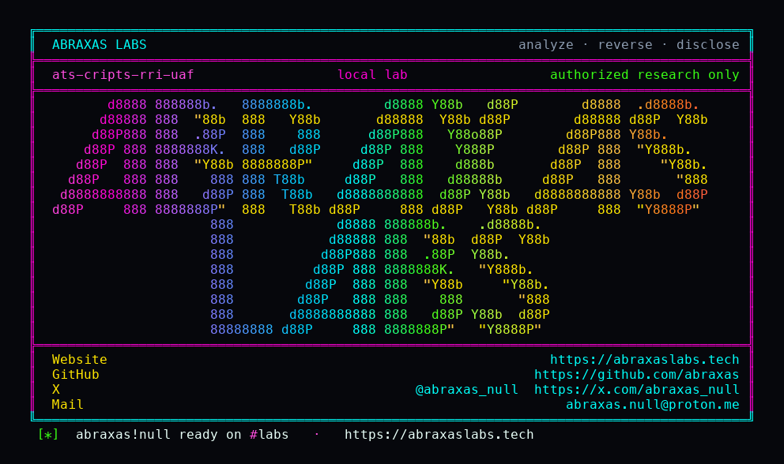

<p align="center">
  
</p>

<p align="center">
  <a href="https://abraxaslabs.tech"><strong>abraxaslabs.tech</strong></a>
  &nbsp;·&nbsp;
  <a href="https://github.com/abraxas">github.com/abraxas</a>
  &nbsp;·&nbsp;
  <a href="https://x.com/abraxas_null">@abraxas_null</a>
  &nbsp;·&nbsp;
  <a href="mailto:abraxas.null@proton.me">abraxas.null@proton.me</a>
  &nbsp;·&nbsp;
  <a href="https://github.com/abraxas/ats-cripts-rri-uaf">ats-cripts-rri-uaf</a>
</p>

# ats-cripts-rri-uaf

**Class:** Crash
**Reach:** Remote

**Apache Traffic Server** `10.2.0` (`b1df7334`) - Apache Software Foundation

Cripts `Remap::From` / `To` URL still re-read the stack `TSRemapRequestInfo` after `TSRemapDoRemap` returns. `RemapPlugins` stack-allocates `rri`. Context keeps the pointer. `reset()` drops the unique_ptrs; later `Get()` / `Host::GetSV` feeds the dead RRI into `TSUrlHostGet`. `Fatal: sdk_sanity_check_mbuffer` then SIGABRT.

`Client::URL` was patched not to. Lua cleared `rri` after remap. Cripts From/To did not. Default `ENABLE_CRIPTS` is off. No cripts on stock remap.

| | |
|---|---|
| ID | no CVE yet |
| Class | **Crash** (UAF of stack RRI) |
| Reach | **Remote** (unauth HTTP through a From/To post-remap cript) |
| CWE | [CWE-416](https://cwe.mitre.org/data/definitions/416.html) |
| CVSS | **High: 7.5** `CVSS:3.1/AV:N/AC:L/PR:N/UI:N/S:U/C:N/I:N/A:H` |
| Product | [Apache Traffic Server](https://github.com/apache/trafficserver) |
| Affected | **10.2.0** (`b1df7334b39a878971c376da849e8da4984918b6`) Cripts From/To URL after DoRemap |
| Auth | none |
| License | [GNU Affero GPL v3.0](LICENSE) |
| Lab | `127.0.0.1:18780` only |

I pinned public tag [10.2.0](https://github.com/apache/trafficserver/releases/tag/10.2.0) peel [b1df7334](https://github.com/apache/trafficserver/commit/b1df7334b39a878971c376da849e8da4984918b6). The lab is a RelWithDebInfo source build with Cripts on. CONTROL Client::URL 200, process stayed up. POC Host `ats-poc` SIGABRT exit 134.

## What an attacker can do

Hit a remap cript that touches From/To URL after `do_remap` (`do_send_response` in the lab). Unauth GET is enough.

| Method | Sink | Privilege |
|---|---|---|
| Unauth GET Host `ats-poc` through a `do_send_response` cript that calls `Remap::From::URL::Get` / `To::URL::Get` | stack `TSRemapRequestInfo` ([`RemapPlugins.cc:41-65`](https://github.com/apache/trafficserver/blob/b1df7334b39a878971c376da849e8da4984918b6/src/proxy/http/remap/RemapPlugins.cc#L41-L65)); `rriValid()` deref ([`Context.hpp:70-73`](https://github.com/apache/trafficserver/blob/b1df7334b39a878971c376da849e8da4984918b6/include/cripts/Context.hpp#L70-L73)); `_initialize` ([`Urls.cc:525-561`](https://github.com/apache/trafficserver/blob/b1df7334b39a878971c376da849e8da4984918b6/src/cripts/Urls.cc#L525-L561)) | **Availability (lab-proven):** SIGABRT, exit 134, connection reset. `traffic_server` dies. |
| Same | SDK Fatal abort | **Integrity:** not RIP control. Class stays Crash. Lab. |

**Lab-proven vs inferred:** process death is lab (RelWithDebInfo SIGABRT). Memory corruption to RIP is not claimed.

**Requires:** Cripts built (`ENABLE_CRIPTS=ON`) and a remap cript that touches From/To URL after `DoRemap`. Default: no.

## Adjacent surface that stays closed

| Surface | Lab |
|---|---|
| CONTROL Client::URL only | 200, process stayed up |
| File::Path::Rebase jail | closed on this pin (CVE-2026-58177 issue 32) |
| Geo IPEndpoint sockaddr | closed |
| Query-key abort | closed (missing hash skipped) |
| Global cripts | `rri == nullptr`; `rriValid()` fail-closes without deref |
| Instance OOB / DoRemap-after-Release | closed (CVE-2026-58177) |
| Stock remap / `ENABLE_CRIPTS` off | leftover does not apply |

Not CVE-2026-58177 as disclosed. Lua cleared `rri` after remap; Cripts From/To did not.

## Lab

```bash
python3 ats-cripts-rri-uaf-Abraxas-Labs.py
```

or

```bash
cd lab
./run.sh
```

Loopback `127.0.0.1:18780`. Compose project `ats-cripts-rri-uaf`. RelWithDebInfo image. Witness `ATS-CRIPTS-RRI-UAF-WITNESS`. Last line:

```
SUCCESS ats-cripts-rri-uaf control-http=200 control-alive=yes poc-crash=sigabrt poc-http=None reset=1 ATS-CRIPTS-RRI-UAF-WITNESS
```

## The fix

Null the Context `rri` when `TSRemapDoRemap` returns, the way Lua does. Or treat From/To URL like `Client::URL`: do not re-init from RRI on later hooks. `rriValid()` must not dereference a dead struct. Copy `mapFromUrl` / `mapToUrl` into owned MLocs during `do_remap` if post-remap From/To is a feature.

Until then, do not evaluate `%{FROM-URL:...}` / `%{TO-URL:...}` (or borrow those URL objects) on `do_post_remap` / `do_send_request` / `do_read_response` / `do_send_response` / `do_cache_lookup`.

## References

- [github.com/apache/trafficserver](https://github.com/apache/trafficserver) tag [10.2.0](https://github.com/apache/trafficserver/releases/tag/10.2.0) (`b1df7334b39a878971c376da849e8da4984918b6`)
- [`src/proxy/http/remap/RemapPlugins.cc`](https://github.com/apache/trafficserver/blob/b1df7334b39a878971c376da849e8da4984918b6/src/proxy/http/remap/RemapPlugins.cc)
- [`include/cripts/Epilogue.hpp`](https://github.com/apache/trafficserver/blob/b1df7334b39a878971c376da849e8da4984918b6/include/cripts/Epilogue.hpp)
- [`src/cripts/Urls.cc`](https://github.com/apache/trafficserver/blob/b1df7334b39a878971c376da849e8da4984918b6/src/cripts/Urls.cc) `Remap::From::URL` / `To::URL`
- [`include/cripts/Context.hpp`](https://github.com/apache/trafficserver/blob/b1df7334b39a878971c376da849e8da4984918b6/include/cripts/Context.hpp) `rriValid`
- CVE-2026-58177 siblings (closed): instance OOB, Rebase `../`, Geo sockaddr, query-key abort, Client::URL MLoc
- [CWE-416](https://cwe.mitre.org/data/definitions/416.html)
